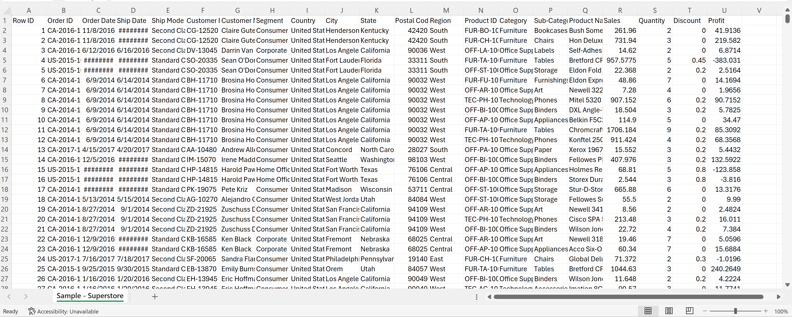
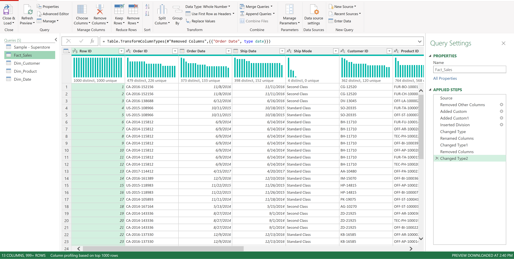
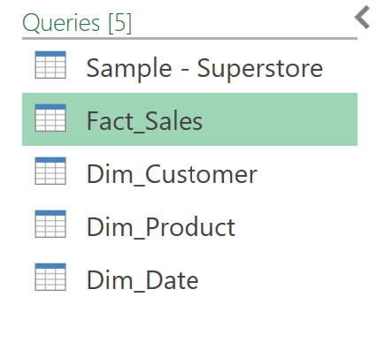
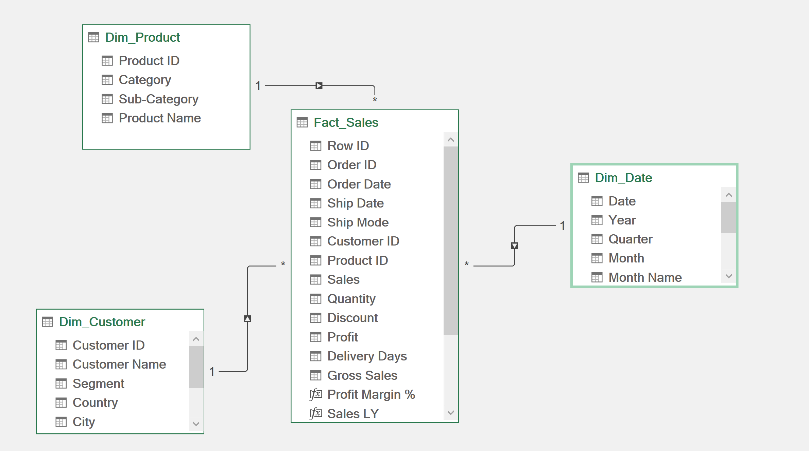
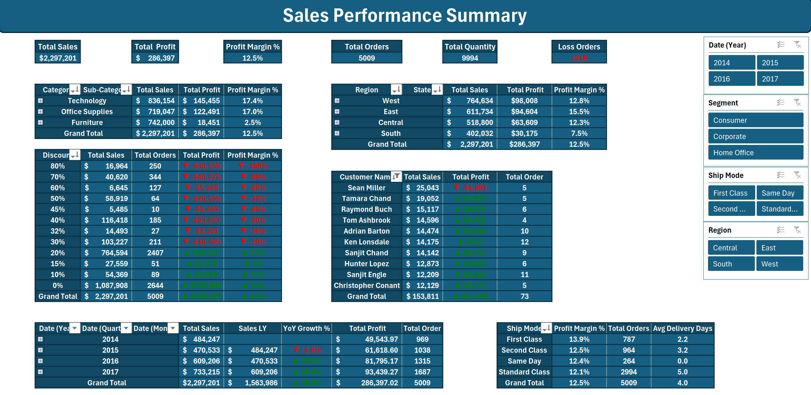
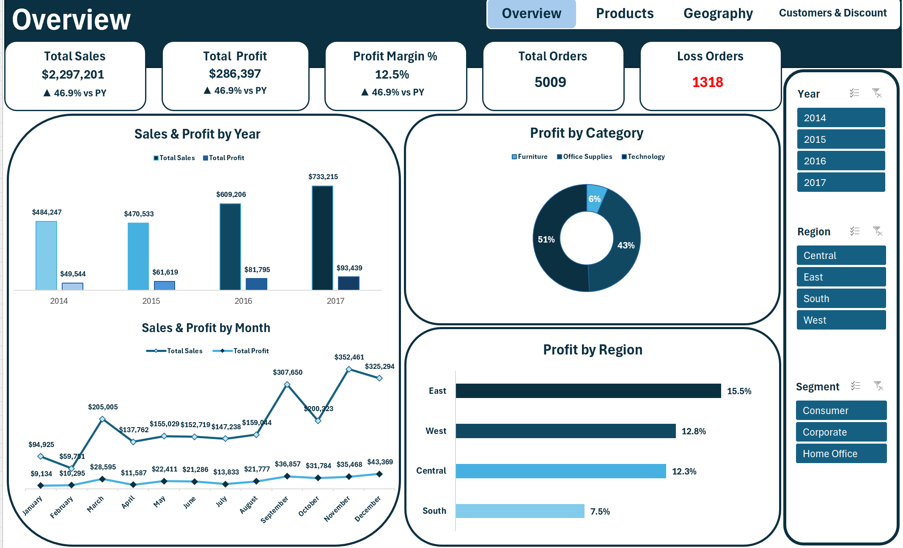
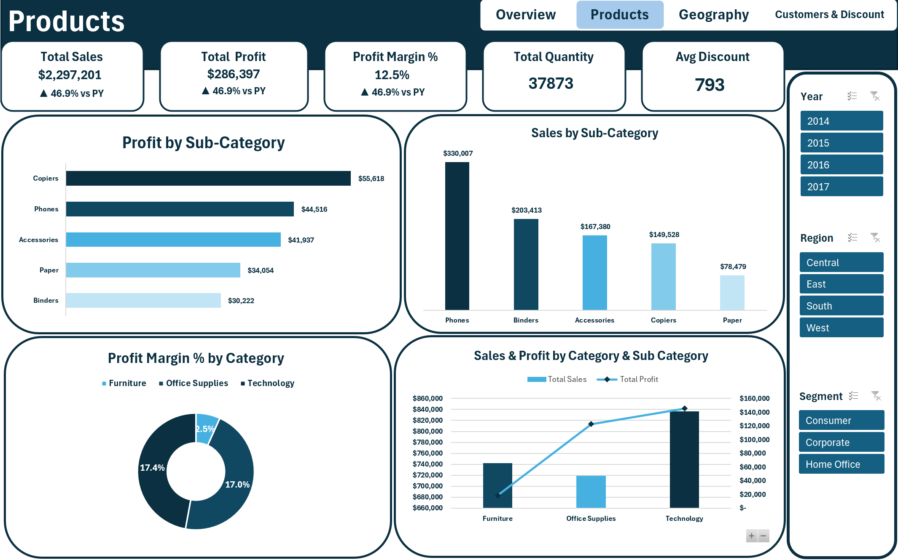
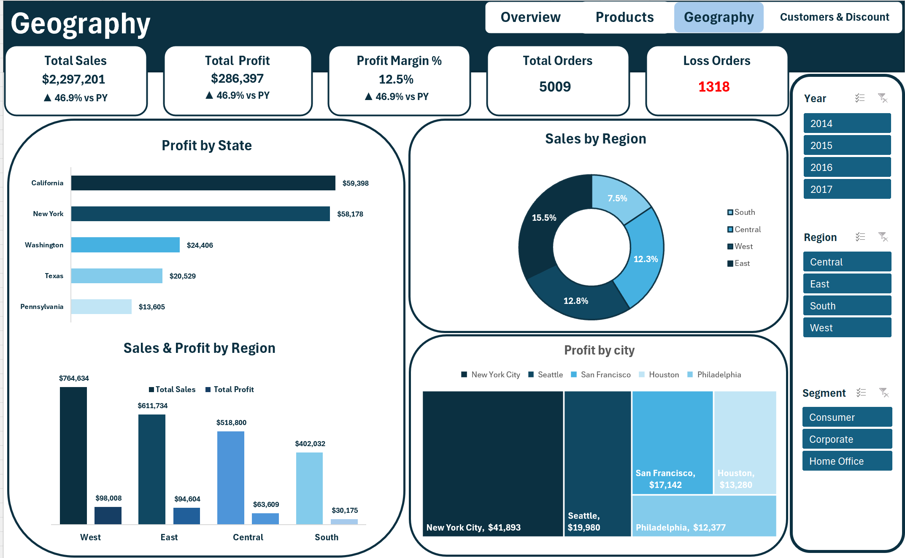
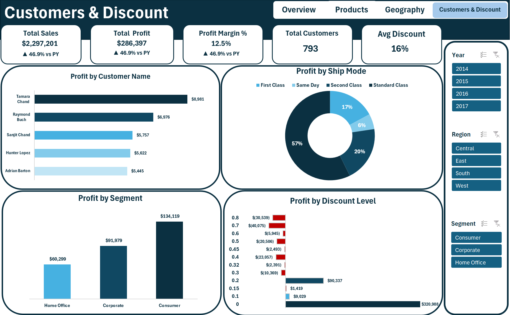

# 📊 Superstore Sales & Profitability Analytics Hub

---

### 👤 Created By:
**Ebrahim Mustafa** — *Data Analyst & BI Analyst*

---

## 📌 نبذة عن المشروع (Project Overview)
يهدف هذا المشروع إلى تقديم تحليل شامل وعميق لبيانات المبيعات والأرباح لشركة **Superstore** (أكثر من 9,900 معاملة بيع بقيمة تجاوزت **2.29 مليون دولار**).

تم بناء التقرير بالكامل باستخدام **Microsoft Excel** باتباع أحدث الممارسات الاحترافية لتطوير لوحات مؤشرات الأداء التفاعلية (Interactive Business Intelligence Dashboards)، مع بناء رحلة متكاملة للبيانات بدءاً من البيانات الخام، مروراً بـ Power Query و Power Pivot والتشارش التفاعلية، وحتى استخراج التوصيات الاستراتيجية.

---

## 🛠️ أدوات وتقنيات العمل (Tech Stack & Workflow)
* **Power Query:** لسحب البيانات الخام وتنظيفها وفصل الجداول المسطحة إلى نموذج أبعاد (Star Schema).
* **Power Pivot & DAX:** لبناء العلاقات بين الجداول وصياغة المقاييس الحسابية المتقدمة (Dynamic DAX Measures).
* **Pivot Tables & Summaries:** لتجميع البيانات الحسابية المعتمدة لتقديمها للشارتات والبطاقات.
* **Pivot Charts & Custom Visuals:** لإنشاء الرسوم البيانية المتنوعة وتربيطها بالسلايسرز التفاعلية (Slicers).

---

## 🚀 رحلة معالجة وتطوير البيانات (Data Pipeline Roadmap)

### 1️⃣ البيانات الخام (Raw Data)
* **الوصف:** جدول مسطح (Flat Table) يحتوي على كربكة وعشوائية في البيانات، تواريخ غير مضبوطة (`########`)، عدم وجود فصل بين الأبعاد والمبيعات، ومشاكل في التنسيقات.

---

### 2️⃣ تنظيف وتجهيز البيانات (Data Cleaning & Power Query)
* **الوصف:** استيراد البيانات إلى **Power Query**، معالجة المشاكل وإعادة هيكلة جدول المعاملات، وتفكيك الجدول المسطح إلى نموذج أبعاد احترافي (**Star Schema**) يحتوي على 4 أبعاد رئيسية (`Fact_Sales`, `Dim_Customer`, `Dim_Product`, `Dim_Date`).

---

### 3️⃣ نمذجة البيانات (Data Modeling & Power Pivot)
* **الوصف:** بناء العلاقات بين جدول الحقائق وجداول الأبعاد (علاقات 1-to-Many) داخل **Power Pivot**، وإنشاء جدول مقاييس حسابية (DAX Measures) لحساب إجمالي المبيعات، الأرباح، نسبة هامش الربح، ومؤشرات النمو السنوي (YoY Growth).

---

### 4️⃣ الجداول المجمعة والحسابات (Pivot Tables Summary)
* **الوصف:** إعداد شيت الحسابات والـ Pivot Tables المجمعة لتغذية الواجهات الرئيسية والبطاقات بالبيانات الديناميكية.

---

## 💻 صفحات الداشبورد التفاعلية (Interactive Dashboard Pages)

### 1️⃣ صفحة النظرة العامة (Overview)
تحديد المؤشرات الرئيسية (Sales, Profit, Profit Margin %, YoY Growth) وتتبع الاتجاه الشهري والسنوي وتوزيع الأرباح حسب المناطق والفئات.

---

### 2️⃣ صفحة تحليل المنتجات (Products Analysis)
تحليل أداء المنتجات والفئات الفرعية (Sub-Categories) وتحديد الفئات الأكثر ربحية والأقل هامش ربح.

---

### 3️⃣ صفحة التحليل الجغرافي (Geography Analysis)
تحليل أداء الولايات والمدن مع استخدام Treemap لتحديد المدن الأكثر مساهمة في الأرباح.

---

### 4️⃣ صفحة العملاء والخصومات (Customers & Discount Analysis)
دراسة سلوك العملاء وشريحة الشحن، وتحديد التأثير المباشر لسياسة الخصومات على ربحية الطلبات.

---

## 💡 الرؤى الاستراتيجية والتوصيات (Business Insights & Recommendations)

1. **إعادة النظر في سياسة الخصومات (Discounting Policy):**
   * **الرؤية:** الخصومات التي تتجاوز نسبة **20%** تؤدي مباشرة إلى خسائر مالية فادحة، حيث تسجل الشركة **1,318 طلب خسارة (Loss Orders)** بسبب الخصومات المرتفعة.
   * **التوصية:** وضع حد أقصى إجباري للخصومات الترويجية لا يتعدى **15% - 20%** لحماية هامش الربح.

2. **تحسين تسعير وهامش ربح فئة الأثاث (Furniture Category):**
   * **الرؤية:** تحقق فئة الأثاث مبيعات عالية جداً (\$742,000)، ولكن بمعدل هامش ربح متدني للغاية يبلغ **2.5%** فقط مقارنة بفئة التكنولوجيا (**17.4%**).
   * **التوصية:** إعادة تقييم أسعار بيع الأثاث (خصوصاً الطاولات والمكتبات) أو خفض تكاليف الشحن والتوريد الخاصة بها لتحسين الربحية.

3. **معالجة التكاليف اللوجستية في المنطقة الجنوبية (South Region):**
   * **الرؤية:** تسجل المنطقة الجنوبية أقل نسبة هامش ربح بين كافة المناطق بحوالي **7.5%**.
   * **التوصية:** مراجعة عقود الشحن وسلاسل الإمداد في الجنوب ونقل الممارسات الناجحة من المنطقة الغربية (West) التي تتصدر الأرباح.

4. **التركيز على الفئات والعملاء الأكثر ربحية:**
   * **الرؤية:** فئة التكنولوجيا (Technology) هي المحرك الأساسي للأرباح (\$145,455) بأعلى هامش ربح.
   * **التوصية:** توجيه الحملات التسويقية نحو منتجات التكنولوجيا، وتنسيق برامج ولاء خاصة لكبار العملاء (مثل العميل Tamara Chand المتصدر للأرباح).

---

### ✍️ Created By:
**Ebrahim Mustafa — Data Analyst & BI Analyst**
